<div align="center">

# Platewise

**An AI design studio for restaurants: food photos, menus, posters, logos and packaging from one line of text.**


[Features](#features) · [Design](#design) · [Screenshots](#screenshots) · [Tech stack](#tech-stack) · [Getting started](#getting-started)

</div>

<br>

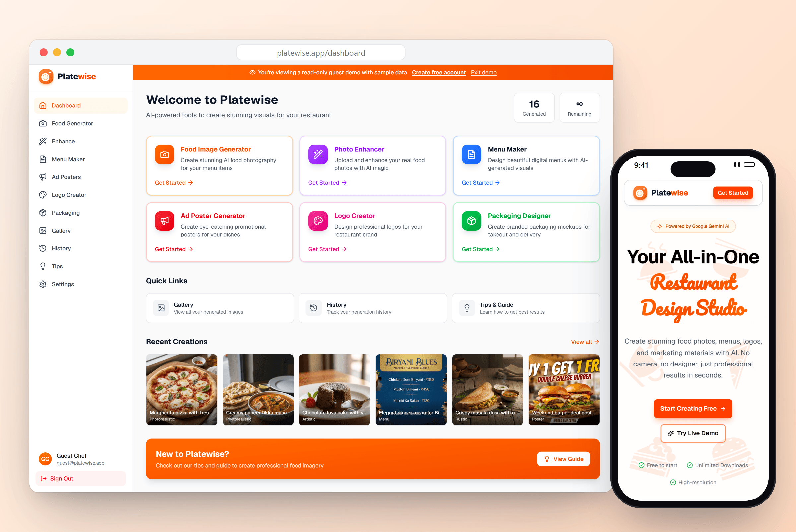

## Overview

Small restaurants need appetizing visuals for menus, delivery apps and social media, but rarely have a photographer or a designer. Platewise turns a line of text into those assets. A cook types "crispy masala dosa with coconut chutney", picks a style and gets a menu-ready photo. The same flow produces full menu layouts, promotional posters, logos and branded takeout packaging.

Every generation is saved to a searchable gallery and logged in a history view with its status and the AI-enhanced prompt, so good results are easy to find and reuse.

## Try the demo

- **Guest demo, no account.** Click **Try Live Demo** on the landing page. You land on the dashboard of a sample restaurant with 16 images and a full history. The demo runs in the browser with no database or API key, and every write action shows a read-only notice.
- **Your own account.** Sign up locally (email confirmation is off in the local Supabase config). Without a Gemini key, the generators return bundled sample images that match the dish in your prompt, so every tool works end to end. Add `GOOGLE_GENERATIVE_AI_API_KEY`, or paste your own key in **Settings**, to generate real images.

## Features

### Food Generator

Describe a dish, choose photorealistic, artistic, minimalist or rustic, and get a menu-ready photo. **Enhance with AI** rewrites a short prompt into a detailed photography brief, and **Surprise Me** suggests ideas when you're stuck.

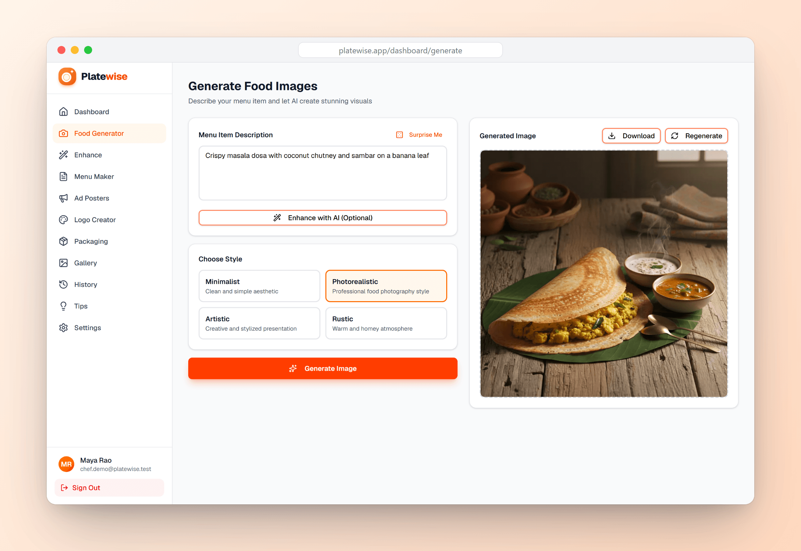

### Menu Maker

Restaurant name, cuisine and a list of dishes with prices in; a styled menu out, in modern minimalist, chalkboard, fine dining or vibrant layouts.

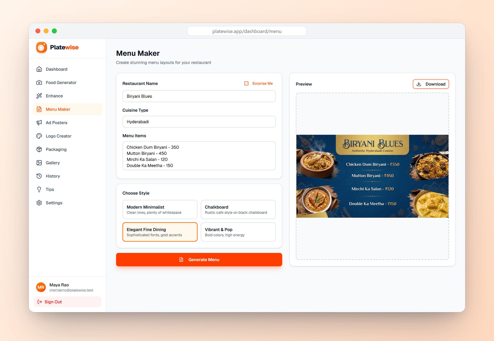

### Gallery

Every creation in one place, with style filters, sorting, weekly stats, download and delete.

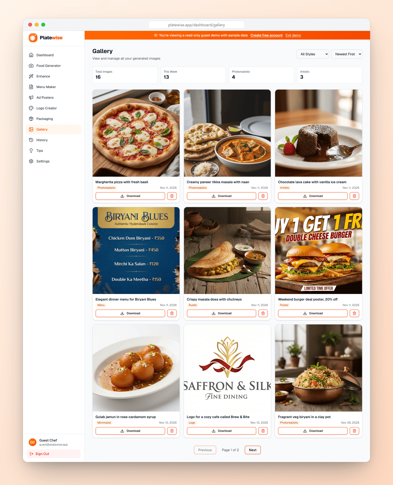

### History

Each attempt is logged with its status (completed or failed), the success rate and the enhanced prompt that produced it.

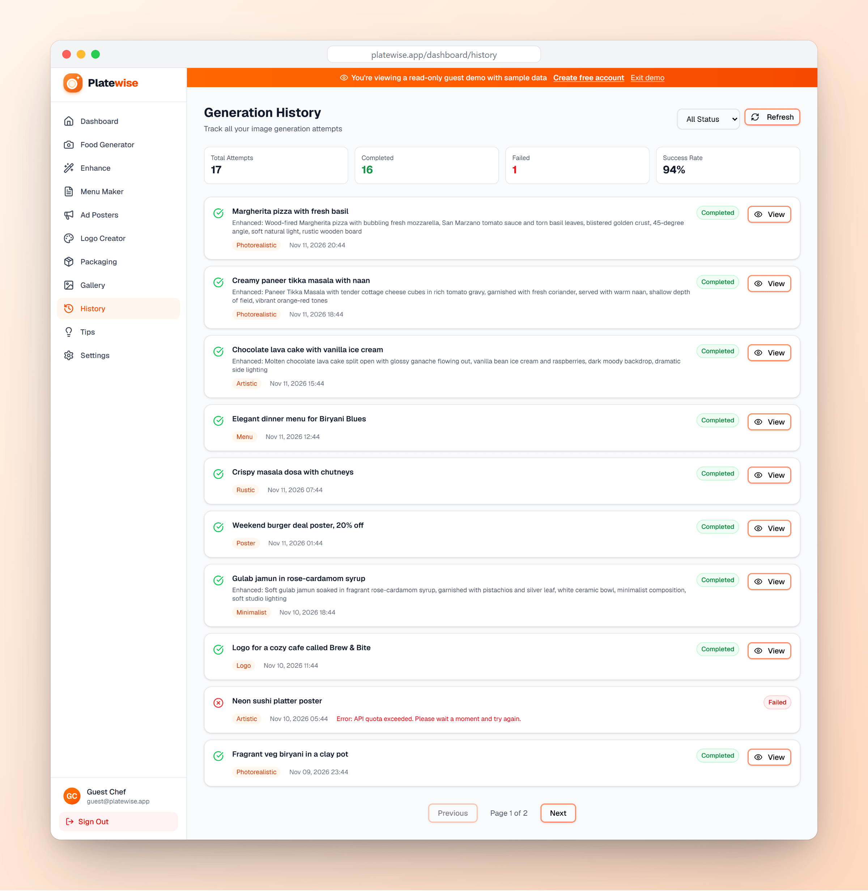

**Also included**
- **Photo Enhancer:** upload a real phone photo; Gemini analyses it and produces a professional version.
- **Ad Posters, Logo Creator, Packaging Designer:** purpose-built prompts for each asset type.
- **Tips and best practices**, profile settings and an optional personal Gemini key stored in the browser.
- **Accounts:** email/password and Google sign-in through Supabase Auth, with Row Level Security so each user only sees their own data.

## Design

- **Color.** One confident brand orange (`oklch(0.65 0.25 45)`) for actions and the active nav item, with a distinct accent color per tool (orange, violet, blue, red, pink, green) so each generator is recognisable at a glance.
- **Typography.** Geist Sans for the interface and Pacifico script for the brand accent in headlines ("Restaurant Design Studio"), loaded through `next/font`.
- **Layout.** A fixed sidebar with icon + label navigation on desktop, generous card spacing and an image-first dashboard where recent creations are the visual focus.
- **Responsive.** On phones the sidebar becomes a bottom tab bar and every tool stacks into a single column, as shown below.
- **States.** Generators show a clear empty preview before the first run, a progress state while generating and a read-only notice in demo mode instead of failing silently.
- **Light only.** The app ships a single light theme; dark mode is not implemented.

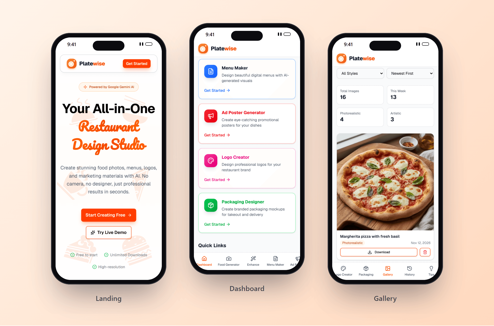

## Screenshots

| | |
| --- | --- |
| 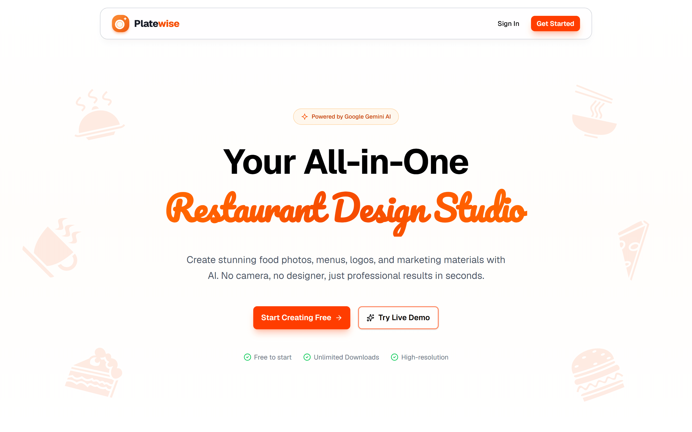<br>**Landing page.** Sign up or jump straight into the demo. | 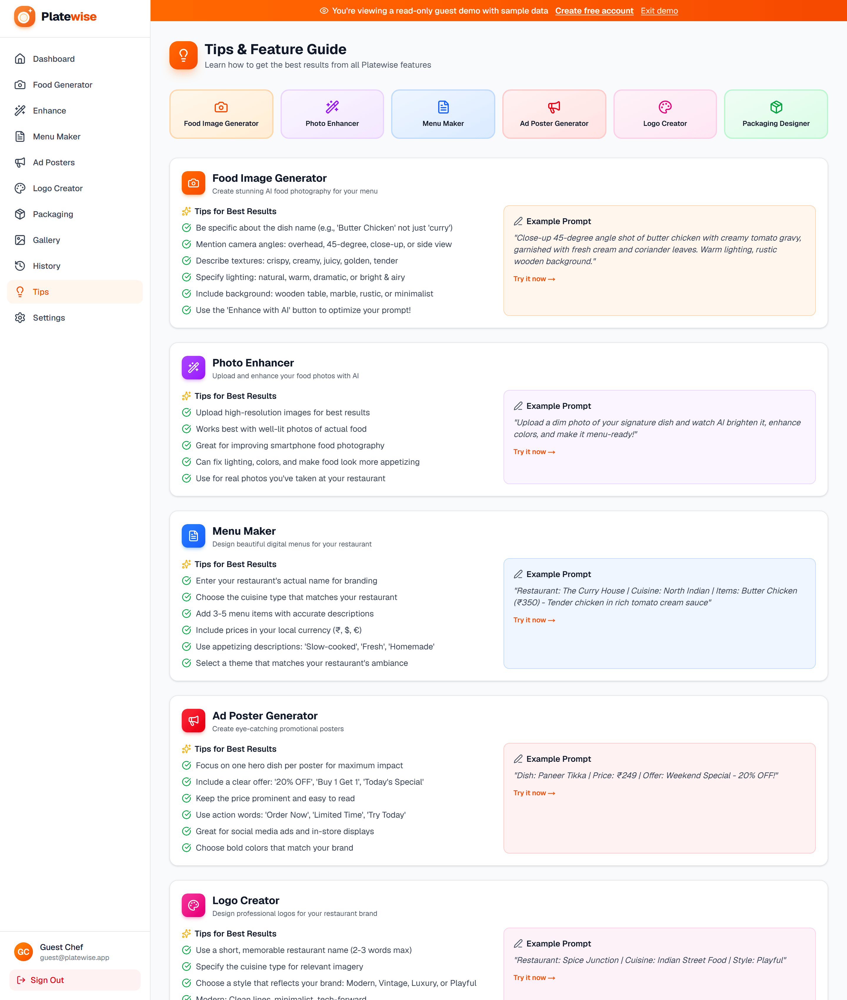<br>**Tips & guide.** Prompt advice and examples for each tool. |
| 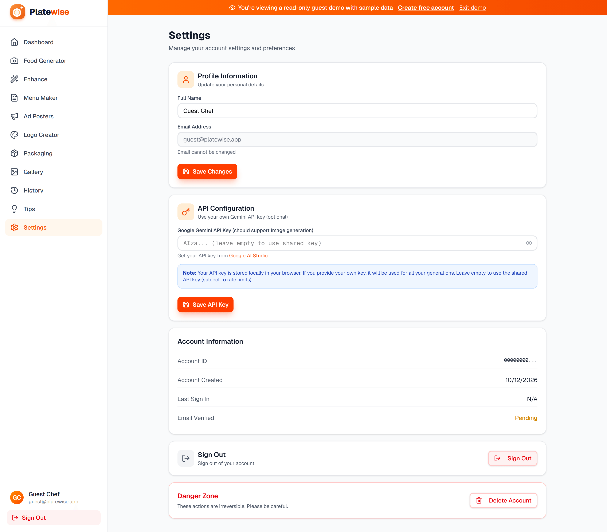<br>**Settings.** Profile, account details and an optional personal Gemini key. | 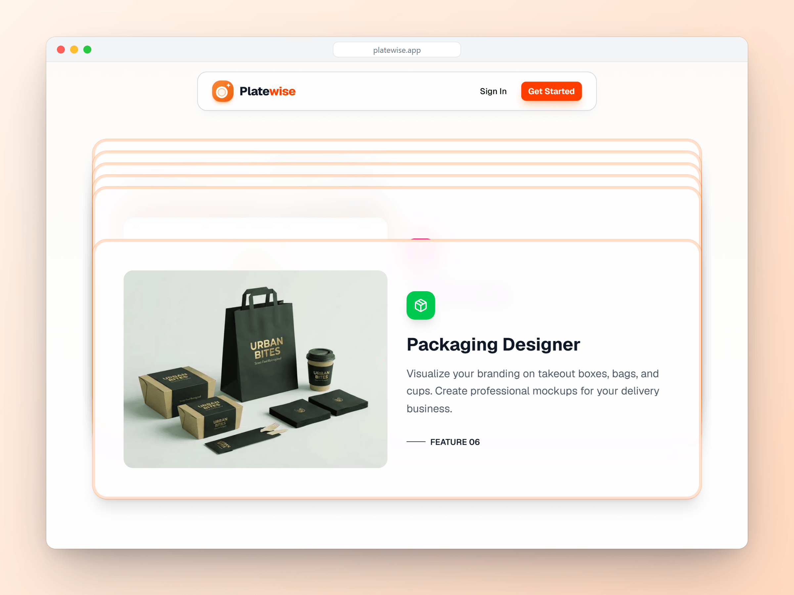<br>**Feature cards.** The landing page stacks one card per tool as you scroll. |
| 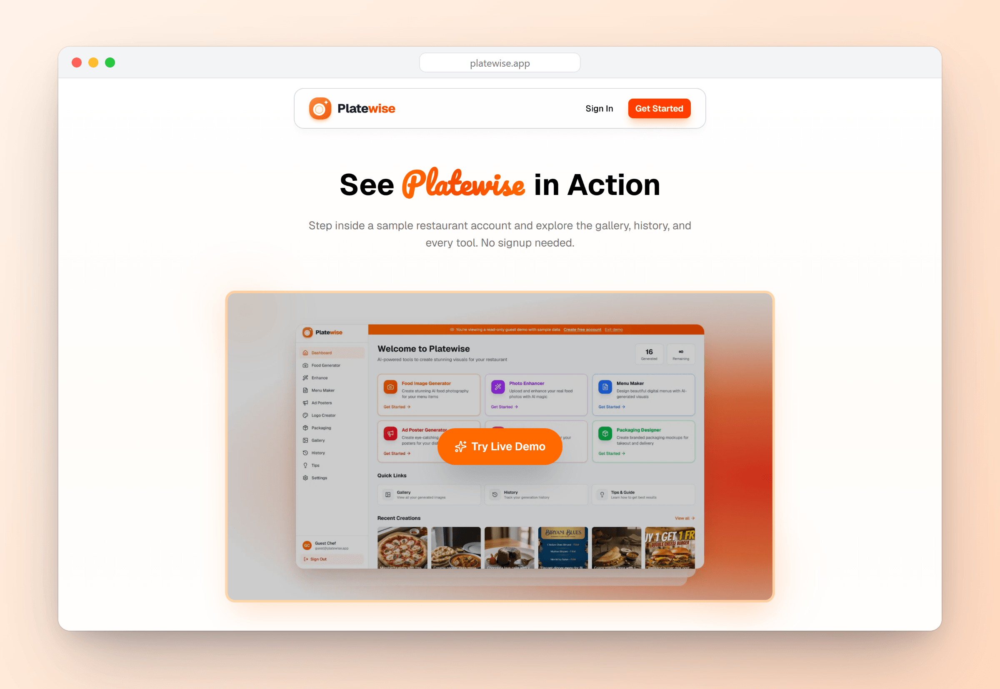<br>**Live demo preview.** The landing page shows the guest dashboard with a Try Live Demo button. | |

## Tech stack

| Layer | Technology | Why |
| --- | --- | --- |
| Framework | Next.js 16.4 (App Router, Turbopack), React 19.2 | Server route handlers for AI calls next to a client-heavy dashboard |
| Language | TypeScript 5.9 | Shared types across routes, Supabase rows and UI |
| Styling | Tailwind CSS 4.1, shadcn/ui, Radix primitives | Accessible primitives with a custom brand layer |
| AI | Vercel AI SDK 5 with `@ai-sdk/google` 2 | One API for Gemini text and image models, easy to swap models |
| Data and auth | Supabase (PostgreSQL, Auth), `@supabase/ssr` 0.7 | Auth, Postgres and RLS in one service, with cookie sessions for SSR |
| UI extras | Embla Carousel 8, date-fns, lucide-react | Landing carousels, date formatting, icons |

## Architecture

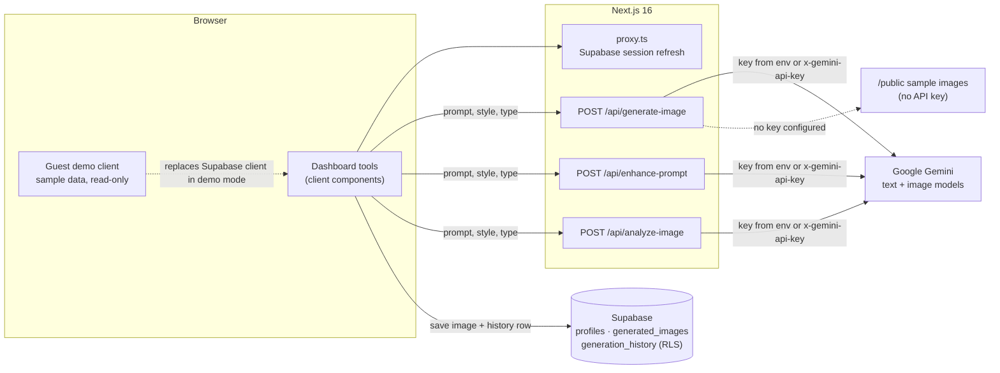

**Key decisions**
- **One AI context per request.** `getAiContext()` resolves the signed-in user and a Gemini provider. A key sent from Settings (`x-gemini-api-key`) wins over the server key, and demo requests are refused with `403`, so the demo can never spend API credit.
- **Prompt templates per asset type.** The image route wraps the user's text in a template for food, menu, poster, logo or packaging, so short inputs still produce composed, on-brand results.
- **Runs without a key.** With no Gemini key, the routes return bundled sample images matched to the dish in the prompt, so the full flow (generate, save, gallery, history) works for local development and reviews.
- **Guest demo in the client.** A cookie switches `createClient()` to an in-memory demo client with sample data. Every write goes through `guardDemo()`.
- **History as an audit trail.** Each attempt writes a `generation_history` row before the call and updates it with the result, so failures are visible next to successes.

## Engineering highlights

- **Authorization in two layers.** Route handlers check the Supabase user before any AI call, and Postgres Row Level Security limits every table to `auth.uid()`, so a bug in the UI can't leak another restaurant's images.
- **Cost safety.** Demo traffic is rejected on the server, not just hidden in the UI, and users can bring their own Gemini key so the shared key isn't the only option.
- **Input checks.** Each route rejects a missing prompt or image with a `400` before it reaches the model.
- **Graceful degradation.** No key, no network or a failed generation each lead to a clear state: sample images, a toast, or a failed row in History.
- **Session handling.** `proxy.ts` refreshes the Supabase session on every request, so server components and route handlers always see a valid user.

```ts
// lib/ai.ts
export async function getAiContext(req: Request) {
  if (req.headers.get("cookie")?.includes(`${DEMO_COOKIE}=1`)) {
    return {
      error: Response.json(
        { error: "Guest demo is read-only. Create a free account to generate." },
        { status: 403 }
      ),
    };
  }

  const supabase = await createClient();
  const { data: { user } } = await supabase.auth.getUser();
  if (!user) {
    return { error: Response.json({ error: "Unauthorized" }, { status: 401 }) };
  }

  const apiKey =
    req.headers.get("x-gemini-api-key") ||
    process.env.GOOGLE_GENERATIVE_AI_API_KEY;

  // No key configured: run in demo mode with sample assets from /public
  if (!apiKey) {
    return { error: undefined, user, google: null };
  }
  // ...
```

```ts
// lib/demo.ts
// Call at the start of any action that would create, change or delete data.
// Returns true (and shows the read-only notice) when in demo mode.
export function guardDemo() {
  if (!isDemoMode()) return false;
  window.dispatchEvent(new Event(DEMO_READONLY_EVENT));
  return true;
}
```

## Getting started

**Prerequisites:** Node.js 20 or newer and npm, Docker for the local Supabase stack, and optionally a Gemini API key from [Google AI Studio](https://aistudio.google.com/apikey).

```bash
git clone <your-fork-url> platewise
cd platewise
npm install
```

Start Supabase locally and apply the schema in `supabase/migrations`:

```bash
npx supabase start
```

```bash
npx supabase db reset
```

Create `.env.local` from the template and fill in the values printed by `npx supabase status`:

```bash
cp env.example .env.local
```

```bash
npm run dev
```

Open http://localhost:3000. You should see the landing page; **Try Live Demo** opens the sample dashboard straight away.

<details>
<summary><b>Environment variables</b></summary>

| Variable | Required | Purpose |
| --- | --- | --- |
| `NEXT_PUBLIC_SUPABASE_URL` | yes | Supabase API URL (local: `http://127.0.0.1:54321`) |
| `NEXT_PUBLIC_SUPABASE_ANON_KEY` | yes | Supabase anon key, protected by RLS |
| `NEXT_PUBLIC_SITE_URL` | yes | Base URL for auth redirects |
| `GOOGLE_GENERATIVE_AI_API_KEY` | optional | Shared Gemini key. Without it, the tools return sample images. |
| `GEMINI_TEXT_MODEL`, `GEMINI_IMAGE_MODEL` | optional | Override the default Gemini models |

</details>

<details>
<summary><b>Scripts</b></summary>

| Script | What it does |
| --- | --- |
| `npm run dev` | Development server on port 3000 |
| `npm run build` | Production build |
| `npm start` | Serve the production build |
| `npm run lint` | ESLint |

</details>

<details>
<summary><b>Project structure</b></summary>

```
app/
  page.tsx                 landing page
  (auth)/                  login, signup and auth server actions
  auth/callback/           OAuth and email link callback
  api/
    generate-image/        image generation for every tool
    enhance-prompt/        prompt rewriting
    analyze-image/         photo analysis for the enhancer
  dashboard/               dashboard, generate, enhance, menu, posters,
                           logo, packaging, gallery, history, tips, settings
components/
  landing/                 hero, carousel, features, how it works, FAQ
  dashboard/               sidebar, mobile nav, demo banner
  brand/ layout/ ui/       logo, navbar, footer, shadcn/ui primitives
lib/
  ai.ts                    AI context, models and sample-image fallback
  demo.ts                  guest demo cookie and read-only guard
  supabase/                browser, server, middleware and demo clients
supabase/
  migrations/              tables, RLS policies and profile trigger
proxy.ts                   session refresh on every request
public/dishes, features/   sample images for the demo and no-key mode
```

</details>

## Testing & quality

There is no automated test suite yet. Type checking passes:

```bash
npx tsc --noEmit
```

```bash
npm run lint
```

## Deployment

Deploy to Vercel with a hosted Supabase project.

1. Create a Supabase project, link it (`npx supabase link --project-ref <ref>`) and run `npx supabase db push`.
2. Under Authentication → URL Configuration, set the Site URL and add `https://<your-domain>/**` to the redirect URLs. Enable the Google provider if you want Google sign-in.
3. Import the repository in Vercel and set the environment variables above, with `NEXT_PUBLIC_SITE_URL=https://<your-domain>`.

## Roadmap

- Store generated images in Supabase Storage instead of base64 data URLs in the `generated_images` table.
- Make the no-key sample matcher prefer the dish name over shared words (a "paneer tikka masala" prompt can return the masala dosa sample).
- Validate request bodies with schemas (Zod is installed but not used yet).
- Add tests for the AI routes, the demo guard and the RLS policies.
- Per-user rate limits and usage quotas for the shared Gemini key.